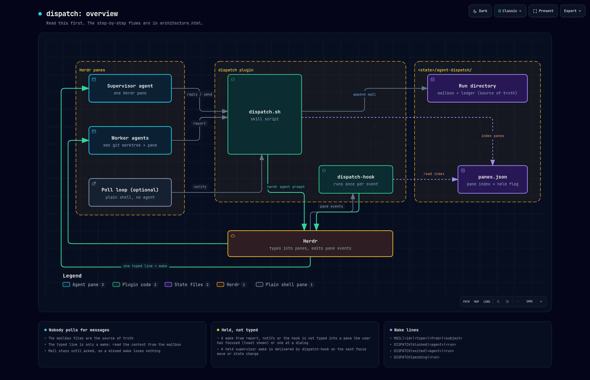

# fleet

Supervise coding agents in [Herdr](https://herdr.dev) without polling them.

A supervisor agent hands work to worker agents, each in its own git worktree. When a worker finishes, has a question or gets stuck, the supervisor is woken by one line typed into its pane. Nothing in the supervisor waits, so there is no watcher to time out and re-arm, and it stays free while workers run.

Herdr gives you `agent prompt` and `agent wait`. This adds what long-running, parallel work needs on top of them: a durable mailbox with typed and acked messages, a ledger of attempts with retries and dependencies, and a lifecycle around each worker.

It builds on three things in the Herdr server: a delivery queue that types a line into a pane only when that is safe, supervision links that report a blocked, stalled or gone worker, and jobs that run a command with no pane. Those are in the [mago0/herdr](https://github.com/mago0/herdr) fork. On a Herdr without them, use this plugin at commit `1dde74a`, version 0.1.0, which carries its own event hook.



## Why not just `herdr agent prompt --wait`?

For a short exchange with an agent beside you, use it. It is simpler. It stops fitting when the work is supervised, long-running or parallel:

- **No watcher to re-arm.** A wait runs inside the supervisor's harness, and harnesses kill long tasks. Here the sender wakes the supervisor, so nothing in it is waiting.
- **The supervisor stays free.** No blocking wait and no idle token cost. One supervisor can hold many workers and hear from them in any order.
- **Real messages, not screen scraping.** Workers send typed mail (`status`, `question`, `escalation`, `worker_done` with an outcome). A wait only says an agent stopped, and reading its terminal can lose output.
- **Durable and acked.** Mail stays until it is acknowledged, so it survives a restart, a context compaction or a missed wake. Herdr events are not replayed. A report carries a key, and a repeat of a key is not sent again, so a worker can resend when it is not sure. A repeat of a message that is not yet acked wakes the supervisor again, so a lost wake is repaired.
- **It does not corrupt a half-typed prompt.** `herdr agent prompt` appends to whatever is in the input box and submits it. A wake goes through Herdr's delivery queue: it is held while you use the target pane (a key press there within `session.delivery_focus_hold_secs`), while the pane holds text you typed and did not send, or its agent works or is at a dialog. You get a toast, and Herdr types it when that ends.
- **Blocked, stalled and dead workers are reported at once**, with the text of the dialog a blocked worker shows.
- **A lifecycle around each worker.** A worktree per task, a ledger of attempts, retries and resumes (5 attempts per task unless forced), dependencies, and an explicit keep or release decision at the end. A resume continues the same conversation in the same worktree.
- **External polls move out of the harness.** A command that watches a chat thread or a pull request runs as a Herdr job, with no pane and no time limit, and wakes an agent only when something changed.

If you have used Orca's orchestration, this is that model for Herdr: runs, typed and acked messages, and a fleet view, with wakes delivered by push.

## What it looks like

The supervisor agent binds a run and starts a worker. In practice the agent runs these from `skill/SKILL.md`; you ask it to "dispatch" something.

```sh
fleet.sh run --name fix-probes
fleet.sh start --repo ~/src/api --branch claude/fix-probe-timeouts --name probes --task task.md
```

The worker opens in its own worktree and pane, with instructions on how to report. The supervisor goes back to whatever it was doing. Later this line is typed into its pane:

```
MAIL|msg_1791236483_162548|worker_done|probes|probe timeouts fixed, PR opened - handle it: fleet.sh read --run fix-probes --id msg_1791236483_162548
```

The line is only a wake. The supervisor reads the message from the mailbox, checks the work, and settles it:

```sh
fleet.sh read --id msg_1791236483_162548
fleet.sh ack  --id msg_1791236483_162548 --decision release    # or retain/reuse with --reason and --until
```

Other lines it can receive:

| Line | Meaning |
|---|---|
| `MAIL\|<id>\|<type>\|<from>\|<subject>` | a worker reported; `question` gets `fleet.sh reply` |
| `HERDR\|blocked\|<agent>\|<pane>\|<what it shows>` | a worker stopped at a permission dialog or question |
| `HERDR\|stalled\|<agent>\|<pane>\|<seconds>` | a worker reports working and its screen does not change |
| `HERDR\|exited\|<agent>\|<pane>` | a worker's agent or pane went away before it reported `worker_done` |

The `HERDR` lines come from the server, through the supervision link that `fleet.sh start` makes.

`fleet.sh ps` shows every attempt with its liveness and the next command to run. That includes an attempt that was to be released and still has its worktree, because the release failed or the command died first. Settling again finishes it.

A kept (retain or reuse) attempt shows `kept` only while it holds something. One that a later attempt of the same agent or task took over shows `replaced by <dispatch>`, and `--tree` hides it. One whose worktree was removed outside fleet, with no agent left on its pane, shows `worktree gone`. `fleet.sh release --dispatch <d>` ends a kept attempt: it removes the worktree when one is there and records the release.

## Nested runs

A worker can bind a run of its own and dispatch workers of its own: a project agent dispatches one agent per issue, and each issue agent dispatches a PR driver and reviewers. `fleet.sh ps --tree` shows all of it from the top:

```
TREE                    DISPATCH  STATUS   OUTCOME  LIVE  ATTENTION  NEXT
run t-proj                                                           supervised from tsup:0; 2 done hidden (--all shows them)
  issue-a               d_ta      working  -        live  none       fleet.sh wait
    run t-a                                                          supervised from ta:1; 1 done hidden (--all shows them)
      review-a          d_ra      working  -        live  none       fleet.sh wait --run t-a
        run t-a-review                                               supervised from ra:1
          loadtest      d_lt      working  -        live  question   fleet.sh reply --run t-a-review --id msg_1793154718920178725_4067045 --body ...
```

Each run sits under the attempt whose pane supervises it. A row that is done (settled, stopped or abandoned, with no mail owed and nothing kept, or kept and replaced) and has nothing shown below it is hidden and counted on its run line. `--all` shows every row, and `--json` gives the same tree nested. `ps` without `--tree` shows one run, as before.

How a run is linked to its parent attempt:

- `fleet.sh run` records the parent in `runs/<run>/parent` when it binds the run from a dispatched worker's pane: the attempt of another run that holds that pane now. A bind from any other pane records no parent.
- A run bound before parents were recorded is linked when the evidence is unambiguous: exactly one attempt held its supervisor pane when that pane last bound the run (the time of the `supervisor` file). An attempt holds its pane from its start until its release, or until it is closed when it keeps no agent.
- Herdr's supervision link of the pane, when it has one, must name the supervisor of that attempt's run. Pane ids are reused, so a released attempt is never linked to a later run on its pane by the id alone.

## Install

```sh
herdr plugin install mago0/herdr-plugins/fleet
root="$(herdr plugin list --plugin fleet --json | jq -r '.result.plugins[0].plugin_root')"
ln -s "$root/skill" ~/.claude/skills/fleet    # or your agent's skills directory
ln -s "$root/bin/fleet" ~/.local/bin/fleet    # the fleet command: fleet.sh on PATH
```

Keep the skill symlinked to the installed plugin and do not copy it, so that the skill text and the scripts stay the same version.

Requirements:

- A Herdr server with `agent deliver`, `pane supervise` and `job` ([mago0/herdr](https://github.com/mago0/herdr), branch `fork`), and with `agent resume` and `agent start --prompt-file` (the fork's agent launch, see its `FORK.md`). On a Herdr without agent resume, `start` and `resume` stop with a message that says so, before a worktree opens.
- `bash`, `jq`, `flock`, `git`; `inotifywait` for an event-driven `fleet.sh wait` (falls back to polling)

### With Nix or devbox

The flake packages fleet with its tools pinned (bash, jq, flock, git, coreutils, and `inotifywait` on Linux), so it needs only Herdr on PATH:

```sh
devbox global add github:mago0/herdr-plugins#fleet    # or: nix profile add github:mago0/herdr-plugins#fleet
share="$(dirname "$(readlink -f "$(command -v fleet)")")/../share/herdr-plugins/fleet"
ln -s "$share/skill" ~/.claude/skills/fleet           # or your agent's skills directory
```

The package does not include Herdr: fleet needs the fork's server, which you install yourself (see the fork's `FORK.md`, it is a Nix package too).

### With Home Manager

The flake exports `homeManagerModules.default`. It installs the packages, links the fleet skill into `~/.claude/skills` and `~/.agents/skills` (set `programs.herdr-plugins.fleet.skillDirs` to change that), and runs `herdr plugin link` on each switch:

```nix
# flake inputs: herdr.url = "github:mago0/herdr/fork"; herdr-plugins.url = "github:mago0/herdr-plugins";
imports = [ herdr.homeManagerModules.default herdr-plugins.homeManagerModules.default ];
programs.herdr.enable = true;
programs.herdr-plugins.fleet.enable = true;
programs.herdr-plugins.tree.enable = true;
```

`fleet.sh adopt` links the live workers of runs that an older version started, so that they show under their supervisor, and records their sessions.

A supervisor that comes back in a new pane runs `fleet.sh run --name <run>` again. When the run's supervisor pane is gone, the run moves to the new pane and its live workers are linked to it. `fleet.sh ps` warns about a gone supervisor pane. A run whose supervisor pane is still open moves only with `--take-over`.

## Row labels

Herdr shows a label at the right edge of an agent's row in the sidebar tree. Fleet writes Herdr's well-known `label` and `link` pane tokens under the source `fleet`. `fleet.sh start --label SRE-142` sets the label on the worker, and `fleet.sh run --label SRE-142` on the supervisor. `--link <url>` on either command sets the web address that the tree opens for the row on ctrl+click, such as that of the issue; with no `--link` the row has no link. A name or a run name that starts with an issue key is split: `sre-142-fix-probes` gives the label `SRE-142` and the agent name `fix-probes`.

## Waking an agent from outside

Chat threads and pull requests cannot push to your machine, so something has to poll them. Give that command to Herdr as a job, and let it wake the agent only when there is news:

```sh
herdr job add pr-watch --every 60s --to lead -- ./pr-news.sh     # exit 0 with text = news, delivered to lead
herdr job add proposals --path proposals.json --to lead -- ./warranted.sh
herdr agent deliver lead "PR 123 has a new push"                 # one line, from any process
```

The same news is not delivered twice in a row, so the command needs no bookkeeping. A job ends when its target pane or the pane that added it closes.

## Limits

- `stalled` finds a frozen agent. An agent that still animates while it waits on a tool that never returns is not found.
- Wake delivery was tested with Claude Code. Other agent kinds queue typed input in their own way.
- `fleet.sh resume` uses Herdr's resume command for the session's kind, so it covers every kind Herdr can resume: claude, codex, copilot, devin, droid, kimi, mastracode, pi, omp, hermes, opencode, qodercli, qwen, kilo, cursor, agy, grok and letta. Other kinds start again from the task with `retry`. A resumed agent cannot know whether its last tool call finished, so it is told to check before it goes on.
- Herdr events are kept in memory. `herdr events read` reports `lost` for a cursor that is too old or from before a restart, and `fleet.sh ps` is the reconcile path.

## How it is built

A skill (`skill/`): `SKILL.md`, the reference agents read, and the scripts they run. `fleet.sh` holds runs, the ledger, the mailbox and the fleet view. Herdr holds the supervision links, the held wake lines and the jobs.

State is under `${XDG_STATE_HOME:-~/.local/state}/agent-fleet/`:

- `runs/<run>/ledger.json`: dispatch attempts, each with its agent's session and transcript path, and the reason for a retain or reuse
- `runs/<run>/inbox.jsonl`: worker to supervisor mail
- `runs/<run>/workers/<agent>/inbox.jsonl`: supervisor to worker mail
- `<inbox>.acked` and `<inbox>.lock`: the acked ids, and the lock. Writers append under an exclusive lock and readers read under a shared one, so no reader sees half a message. A line that does not parse is skipped.
- `runs/<run>/supervisor`: the pane that gets the run's wake lines, set by `fleet.sh run`
- `runs/<run>/parent`: the attempt whose pane bound the run, for `ps --tree`; with no `dispatch` when the pane was no attempt's

Diagrams of version 0.1.0, as standalone HTML to open locally: `docs/overview.html` and `docs/architecture.html`. They still show the event hook, which Herdr replaced.

## Old names

The plugin was called dispatch. The old names still work, so a live session or a saved worker prompt that uses them goes on working:

- `dispatch/` is a link to `fleet/`, and `dispatch.sh` and `herdr-dispatch.sh` are links beside `fleet.sh` and `herdr-fleet.sh`. When a caller comes in through an old path, the commands the scripts print name `fleet.sh` by the fleet path, if one leads to the same scripts.
- State is in `agent-fleet`. While only `agent-dispatch` exists, the scripts and the tree plugin use that. A link at `agent-dispatch` to `agent-fleet` works too.
- `FLEET_RUN` and `FLEET_MAX_ATTEMPTS` come first. `DISPATCH_RUN` and `DISPATCH_MAX_ATTEMPTS` still work.
- Ledger and mail fields keep their names: the `dispatch` field, `d_` ids and `--dispatch`.
- Release also takes the `dispatch_parent=1` token of a parent workspace.

To keep an old skills path such as `~/.agents/skills/dispatch/scripts/fleet.sh` working with no second skill listed, make `dispatch` a directory that holds only a `scripts` link. A harness lists a directory as a skill only when it holds a `SKILL.md`:

```sh
mkdir ~/.agents/skills/dispatch && ln -s ../fleet/scripts ~/.agents/skills/dispatch/scripts
```

## Test

```sh
test/smoke.sh
test/compat.sh
```

`smoke.sh` runs every `fleet.sh` command that needs no live agent against a throwaway state directory. It needs a running Herdr server with delivery queues. A shim stands in for Herdr's agent start and agent resume, as a server with them and as one without.

`compat.sh` runs a full cycle (start, question, reply, `worker_done`, release) through each old path and the new ones, and across the state layouts: only `agent-dispatch`, both with a link at `agent-dispatch`, and only `agent-fleet`. A Herdr shim stands in for the server, so it needs none.
